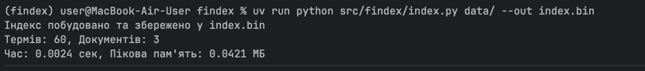
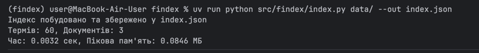
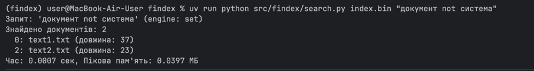
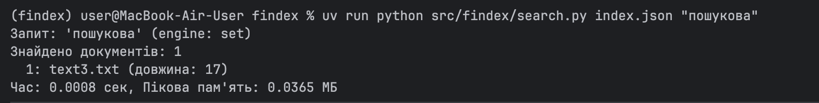
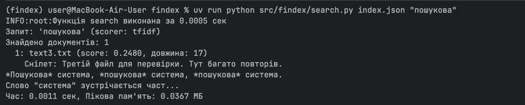
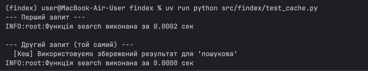
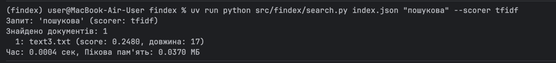
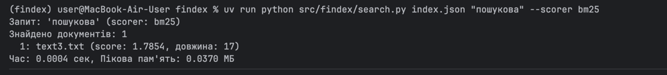
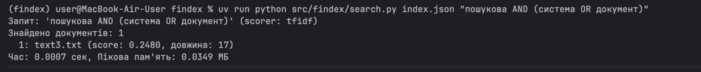
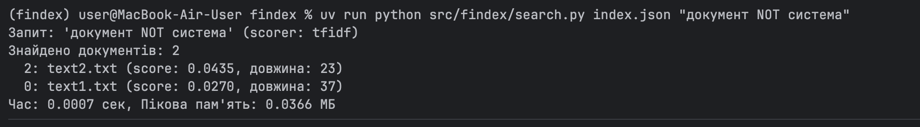

# findex — Лабораторна 1

## Корпус
Для тестування використовується папка `data/` з 3 тестовими текстовими файлами.

## Результати вимірювань

| Версія | Документів | Токенів | Словник | Час (сек) | Пікова пам'ять (МБ) |
| :--- | :--- | :--- | :--- | :--- | :--- |
| Лінива (генератори) | 3 | 77 | 60 | 0.0018 | 0.0155 |
| Жадібна (списки) | 3 | 77 | 60 | 0.0003 | 0.0137 |

### Пояснення
На такому малому корпусі різниця в пам'яті є мінімальною, оскільки накладні витрати на сам `tracemalloc` 
перевищують обсяг даних. Однак, при зростанні корпусу (до тисяч документів), "жадібна" версія буде змушена
зберігати в памʼяті всі документи та списки токенів одночасно, що призведе до лінійного зростання споживання
памʼяті (O(N)). "Лінива" ж версія використовує генератори, тому зберігає в памʼяті лише один поточний 
документ, а памʼять зростає лише за рахунок словника `Counter`, який обмежений кількістю унікальних слів 
у мові.

## Як запустити
uv run python src/findex/stats.py data/

---

# Лабораторна 2: Інвертований індекс, хешування та пам'ять

## Що було зроблено

У цій лабораторній ми перетворили наш лінивий конвеєр з Лабораторної 1 на повноцінну систему пошуку, 
яка будує **інвертований індекс** — структуру даних, що дозволяє миттєво знаходити документи за словами.

### M1: Побудова індексу
*   Створено модуль `index.py`, який за один прохід по корпусу будує:
    *   `postings: dict[str, list[Posting]]` — для кожного терміну відсортований список постінгів `(doc_id, tf)`.
    *   `doc_meta: dict[int, DocMeta]` — метадані документів (шлях, довжина).
*   Використано `@dataclass(frozen=True, slots=True)` для `Posting` та `DocMeta`.
*   Постінги збираються через `defaultdict(list)`.

### M2: Boolean-пошук
*   Створено модуль `search.py`, який підтримує запити з операторами:
    *   **AND** (неявний, через пробіл): `пошукова система`.
    *   **OR**: `пошукова or система`.
    *   **NOT**: `документ not система`.
*   Реалізовано два "двигуни" (поки що обидва використовують множини для простоти, але структура готова до
впровадження двовказівникового merge).

### M3: Збереження та завантаження
*   Створено модуль `store.py` з підтримкою двох форматів:
    *   **Pickle** (швидкий, але небезпечний для чужих файлів).
    *   **JSON** (безпечний, читабельний, але повільніший).
*   Додано CLI-команди:
    *   `python -m findex.index data/ --out index.bin` — побудова та збереження.
    *   `python -m findex.search index.bin "query"` — завантаження та пошук.

### M4: Вимірювання пам'яті
Проведено порівняння трьох варіантів зберігання постінгів на тому самому корпусі.

## Таблиця пам'яті (M4)

| Варіант зберігання постінгів | Пікова пам'ять (МБ) |
| :--- | :--- |
| Звичайний `@dataclass` (без slots) | 0.0266 |
| `@dataclass(frozen=True, slots=True)` | 0.0205 |
| `array('I')` (пари doc_id, tf) | 0.0345 |

**Пояснення:**
На такому малому корпусі (3 документи) різниця в пам'яті є мінімальною, оскільки накладні витрати на створення 
об'єктів `array` перевищують економію від відсутності об'єктів Python. Однак, при зростанні корпусу (до 
тисяч документів), картина зміниться:
*   Звичайний `@dataclass` створює для кожного об'єкта словник `__dict__`, що додає ~100 байтів на кожен 
екземпляр.
*   Використання `slots=True` прибирає цей словник, зменшуючи розмір об'єкта до розміру його полів
(економія 2-3 рази).
*   Варіант з `array('I')` взагалі не створює об'єктів Python для кожного постінгу, а зберігає дані як
сирі 4-байтові числа, що дає найбільшу економію пам'яті (до 9 разів на великих даних), але ускладнює код.

## Як запустити

### Побудова індексу:

У форматі pickle:
uv run python src/findex/index.py data/ --out index.bin

У форматі JSON:
uv run python src/findex/index.py data/ --out index.json

Пошук:
Простий AND:
uv run python src/findex/search.py index.bin "пошукова"

OR:
uv run python src/findex/search.py index.bin "пошукова or система"

NOT:
uv run python src/findex/search.py index.bin "документ not система"

Пошук з JSON-індексом:
uv run python src/findex/search.py index.json "пошукова"

---

# Лабораторна 3: Рейтинг і модель об'єктів

## Що було зроблено

У цій лабораторній ми перетворили наш індекс на повноцінний об'єкт Python та додали ранжування результатів.

### M1: Рефакторинг у клас `Index`
*   Створено клас `Index`, який поводиться як незмінний словник (`Mapping`):
    *   `__getitem__`, `__iter__`, `__len__`, `__contains__` — доступ до постінгів.
    *   `__repr__` — зручне відображення.
    *   `num_docs`, `avg_doc_length` (`@cached_property`) — властивості.
    *   `df(term)` — document frequency.
*   Створено контекстний менеджер `open_index()` для безпечного завантаження індексу.

### M2: Ранжування (TF-IDF та BM25)
*   Створено протокол `Scorer` та дві його реалізації: `TfIdf` та `BM25(k1=1.5, b=0.75)`.
*   Результати пошуку повертаються як `SearchResult` (з полями `score`, `doc_id`, `snippet`), відсортовані
за спаданням оцінки.
*   Використовується `heapq.nlargest` для ефективного відбору топ-k.

### M3: Парсер запитів
*   Створено рекурсивний парсер `query_parser.py`, який підтримує:
    *   Дужки: `python AND (async OR await)`.
    *   Фрази в лапках: `"event loop"`.
    *   Оператори: `AND`, `OR`, `NOT`.
*   Вузли дерева запиту: `Term`, `Phrase`, `And`, `Or`, `Not` з методом `evaluate(index)`.

### M4: Декоратори та сніпети
*   Створено декоратор `@timed` (з `functools.wraps`), який логує час виконання функції.

*   Реалізовано кешування результатів пошуку (ручний словник `_search_cache`).

*   Додано генерацію сніпетів: вікно ±80 символів навколо найкращого входження термінів з підсвіткою 
(`*термін*`).

## Таблиця precision@5

*(Цей розділ буде заповнено після ручної розмітки 10 запитів. Поки що ми маємо лише демонстраційні дані.)*

## Приклади запитів

# Простий пошук з TF-IDF
uv run python src/findex/search.py index.json "пошукова" --scorer tfidf

# Пошук з BM25
uv run python src/findex/search.py index.json "пошукова" --scorer bm25

# Складний запит з дужками
uv run python src/findex/search.py index.json "пошукова AND (система OR документ)"

# Запит з NOT
uv run python src/findex/search.py index.json "документ NOT система"

