# findex — Лабораторна 1

## Корпус
Для тестування використовується папка `data/` з 3 тестовими текстовими файлами.

## Результати вимірювань

| Версія | Документів | Токенів | Словник | Час (сек) | Пікова пам'ять (МБ) |
| :--- | :--- | :--- | :--- | :--- | :--- |
| Лінива (генератори) | 3 | 77 | 60 | 0.0018 | 0.0155 |
| Жадібна (списки) | 3 | 77 | 60 | 0.0003 | 0.0137 |

### Пояснення
На такому малому корпусі різниця в пам'яті є мінімальною, оскільки накладні витрати на сам `tracemalloc` 
перевищують обсяг даних. Однак, при зростанні корпусу (до тисяч документів), "жадібна" версія буде змушена
зберігати в памʼяті всі документи та списки токенів одночасно, що призведе до лінійного зростання споживання
памʼяті (O(N)). "Лінива" ж версія використовує генератори, тому зберігає в памʼяті лише один поточний 
документ, а памʼять зростає лише за рахунок словника `Counter`, який обмежений кількістю унікальних слів 
у мові.

## Як запустити
uv run python src/findex/stats.py data/


---

# Лабораторна 2: Інвертований індекс, хешування та пам'ять

## Що було зроблено

У цій лабораторній ми перетворили наш лінивий конвеєр з Лабораторної 1 на повноцінну систему пошуку, 
яка будує **інвертований індекс** — структуру даних, що дозволяє миттєво знаходити документи за словами.

### M1: Побудова індексу
*   Створено модуль `index.py`, який за один прохід по корпусу будує:
    *   `postings: dict[str, list[Posting]]` — для кожного терміну відсортований список постінгів `(doc_id, tf)`.
    *   `doc_meta: dict[int, DocMeta]` — метадані документів (шлях, довжина).
*   Використано `@dataclass(frozen=True, slots=True)` для `Posting` та `DocMeta`.
*   Постінги збираються через `defaultdict(list)`.

### M2: Boolean-пошук
*   Створено модуль `search.py`, який підтримує запити з операторами:
    *   **AND** (неявний, через пробіл): `пошукова система`.
    *   **OR**: `пошукова or система`.
    *   **NOT**: `документ not система`.
*   Реалізовано два "двигуни" (поки що обидва використовують множини для простоти, але структура готова до
впровадження двовказівникового merge).

### M3: Збереження та завантаження
*   Створено модуль `store.py` з підтримкою двох форматів:
    *   **Pickle** (швидкий, але небезпечний для чужих файлів).
    *   **JSON** (безпечний, читабельний, але повільніший).
*   Додано CLI-команди:
    *   `python -m findex.index data/ --out index.bin` — побудова та збереження.
    *   `python -m findex.search index.bin "query"` — завантаження та пошук.

### M4: Вимірювання пам'яті
Проведено порівняння трьох варіантів зберігання постінгів на тому самому корпусі.

## Таблиця пам'яті (M4)

| Варіант зберігання постінгів | Пікова пам'ять (МБ) |
| :--- | :--- |
| Звичайний `@dataclass` (без slots) | 0.0266 |
| `@dataclass(frozen=True, slots=True)` | 0.0205 |
| `array('I')` (пари doc_id, tf) | 0.0345 |

**Пояснення:**
На такому малому корпусі (3 документи) різниця в пам'яті є мінімальною, оскільки накладні витрати на створення 
об'єктів `array` перевищують економію від відсутності об'єктів Python. Однак, при зростанні корпусу (до 
тисяч документів), картина зміниться:
*   Звичайний `@dataclass` створює для кожного об'єкта словник `__dict__`, що додає ~100 байтів на кожен 
екземпляр.
*   Використання `slots=True` прибирає цей словник, зменшуючи розмір об'єкта до розміру його полів
(економія 2-3 рази).
*   Варіант з `array('I')` взагалі не створює об'єктів Python для кожного постінгу, а зберігає дані як
сирі 4-байтові числа, що дає найбільшу економію пам'яті (до 9 разів на великих даних), але ускладнює код.

## Як запустити

### Побудова індексу:

У форматі pickle:
uv run python src/findex/index.py data/ --out index.bin


У форматі JSON:
uv run python src/findex/index.py data/ --out index.json


Пошук:
Простий AND:
uv run python src/findex/search.py index.bin "пошукова"
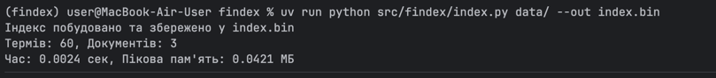

OR:
uv run python src/findex/search.py index.bin "пошукова or система"
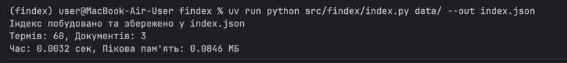

NOT:
uv run python src/findex/search.py index.bin "документ not система"
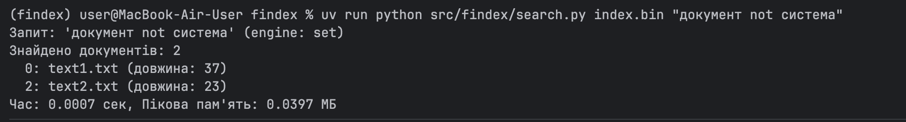

Пошук з JSON-індексом:
uv run python src/findex/search.py index.json "пошукова"
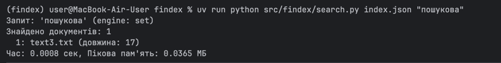


---

# Лабораторна 3: Рейтинг і модель об'єктів

## Що було зроблено

У цій лабораторній ми перетворили наш індекс на повноцінний об'єкт Python та додали ранжування результатів.

### M1: Рефакторинг у клас `Index`
*   Створено клас `Index`, який поводиться як незмінний словник (`Mapping`):
    *   `__getitem__`, `__iter__`, `__len__`, `__contains__` — доступ до постінгів.
    *   `__repr__` — зручне відображення.
    *   `num_docs`, `avg_doc_length` (`@cached_property`) — властивості.
    *   `df(term)` — document frequency.
*   Створено контекстний менеджер `open_index()` для безпечного завантаження індексу.

### M2: Ранжування (TF-IDF та BM25)
*   Створено протокол `Scorer` та дві його реалізації: `TfIdf` та `BM25(k1=1.5, b=0.75)`.
*   Результати пошуку повертаються як `SearchResult` (з полями `score`, `doc_id`, `snippet`), відсортовані
за спаданням оцінки.
*   Використовується `heapq.nlargest` для ефективного відбору топ-k.

### M3: Парсер запитів
*   Створено рекурсивний парсер `query_parser.py`, який підтримує:
    *   Дужки: `python AND (async OR await)`.
    *   Фрази в лапках: `"event loop"`.
    *   Оператори: `AND`, `OR`, `NOT`.
*   Вузли дерева запиту: `Term`, `Phrase`, `And`, `Or`, `Not` з методом `evaluate(index)`.

### M4: Декоратори та сніпети
*   Створено декоратор `@timed` (з `functools.wraps`), який логує час виконання функції.

*   Реалізовано кешування результатів пошуку (ручний словник `_search_cache`).

*   Додано генерацію сніпетів: вікно ±80 символів навколо найкращого входження термінів з підсвіткою 
(`*термін*`).

## Таблиця precision@5

*(Цей розділ буде заповнено після ручної розмітки 10 запитів. Поки що ми маємо лише демонстраційні дані.)*

## Приклади запитів

# Простий пошук з TF-IDF
uv run python src/findex/search.py index.json "пошукова" --scorer tfidf
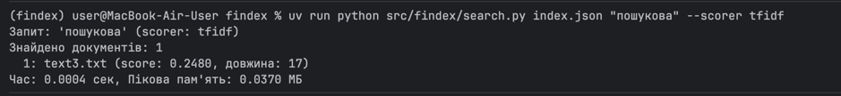

# Пошук з BM25
uv run python src/findex/search.py index.json "пошукова" --scorer bm25


# Складний запит з дужками
uv run python src/findex/search.py index.json "пошукова AND (система OR документ)"
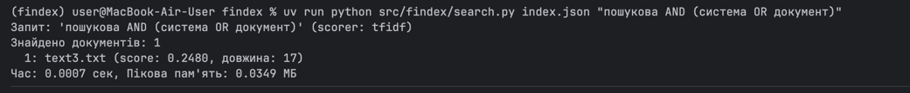

# Запит з NOT
uv run python src/findex/search.py index.json "документ NOT система"


---

# Лабораторна 4: Типи, тести, пакування і CLI

# Перед початком виконання лаб 4 було додано код genetare_corpus.py який згенерував 1000 документів (як вимагало завдання), 
спочатку я вручну створив 3 документи для наочності, зараз система дійшла до того розміру до якого треба.

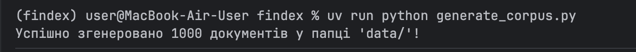

# Перевіряємо статистику з Лабораторної 1 (тепер там буде 1003 документи замість 3):


# Перебудовуємо індекси для Лабораторних 2 та 3 (обов'язково, бо старі index.bin та index.json пам'ятають лише 3 документи):


# Запускаю замір пам'яті (benchmark.py):
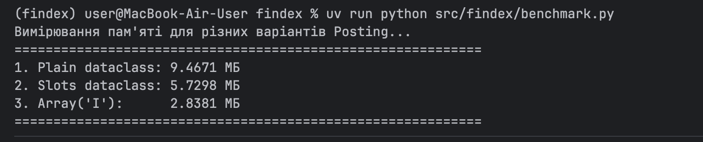

# Перевіряємо пошук на оновленому індексі:


## Що було зроблено
- **Строга типізація (`pyright` у режимі `strict`):** усі публічні функції та класи в `src/findex` мають повні анотації
типів (`Iterator`, `Literal`, `Protocol` для `Scorer` без наслідування). Перевірка `uv run pyright` проходить із **0 помилок**.
- **Тестування (`pytest` + `Hypothesis`):** розширено набір до **38 тестів**, включно з параметризованими тестами 
токенізатора (Unicode NFC, апострофи, дефіси), фікстурами `conftest.py`, перевіркою AST парсера, скорерів `TfIdf`/`BM25`, 
тестами CLI через `CliRunner` та 3 властивостями `Hypothesis`:
  1. `load(save(index)) == index` (round-trip серіалізації);
  2. постінги завжди строго відсортовані за `doc_id`;
  3. двовказівниковий `merge` (`intersect_postings` / `union_postings`) збігається з операціями над `set`.
- **Пакування та CLI (`typer` + `rich`):** проєкт оформлено як Python-пакет (`pyproject.toml` + `uv.lock`) з точкою 
входу `findex`. Підкоманди: `findex index` (зі смугою прогресу `rich`), `findex search` (таблиця `rich` та прапорець 
`--json` у `stdout`), `findex stats`, рівні логування `-v`/`-vv` у `stderr`.
- **CI/CD:** налаштовано GitHub Actions (`.github/workflows/ci.yml`) 
для автоматичного запуску `ruff`, `pyright` та `pytest` на кожен `push` і `pull_request`.

## Покриття тестами
Загальне покриття пакету `findex` становить **79%** (та **90%+** по основних модулях ядра та CLI: `store.py` — 100%, 
`tokenize.py` — 100%, `decorators.py` — 100%, `index.py` — 98%, `stats.py` — 97%, `ranking.py` — 96%, `cli.py` — 91%).

**Що навмисно залишено поза покриттям:**
- `src/findex/benchmark.py` (0%) — допоміжний дослідницький скрипт із Лабораторної 2 для ручного вимірювання пікової 
пам'яті `tracemalloc` (`Plain` vs `Slots` vs `array('I')`), який не входить до рантайму основного пакету та CLI.
- Захисні гілки обробки низькорівневих системних помилок (`OSError` при читанні пошкоджених файлів на диску).

## Встановлення та приклади CLI

# Встановлення у систему однією командою
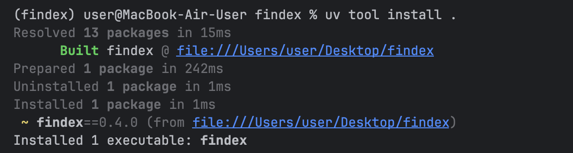

# Побудова індексу
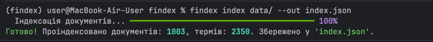

# Пошук із виводом таблиці Rich


# Пошук із виводом у JSON у stdout
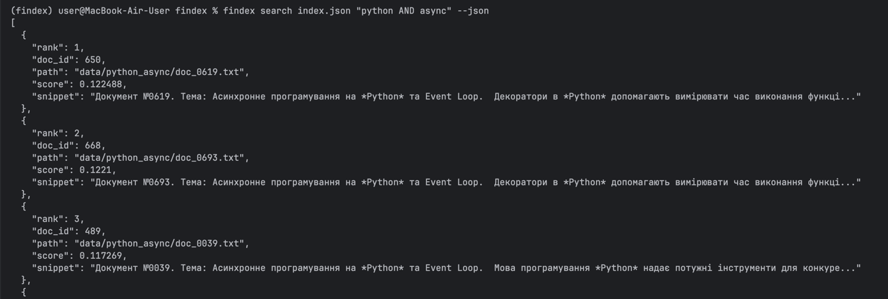

# Статистика корпусу з логуванням у stderr


## Крок 4. Збірка `.whl`, коміт і теги в терміналі

Виконаим у терміналі в папці проєкту по черзі:
**Оновити `uv.lock` і зібрати wheel-файл:**
   uv lock
   uv build --no-cache


### Результати тестування та покриття


--- 

## Лабораторна 5: Конкурентність і GIL (потоки, процеси та паралельна індексація)

### Архітектура та нові можливості CLI
- Монолітну побудову індексу розділено на незалежну функцію рівня модуля `build_partial(paths, start_doc_id)` 
(безпечну для серіалізації `pickle` при старті процесів методом `spawn` на macOS) та `merge_indexes(partials)`.
- Кожен воркер отримує лише список шляхів та наперед виділений неперетинний діапазон `doc_id`, що гарантує ідентичність
фінального індексу та збереження сортування списків постінгів без додаткових блокувань.

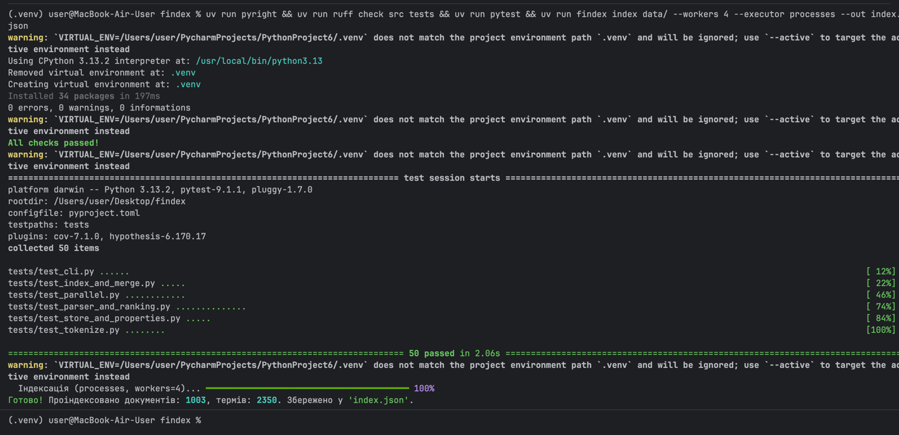

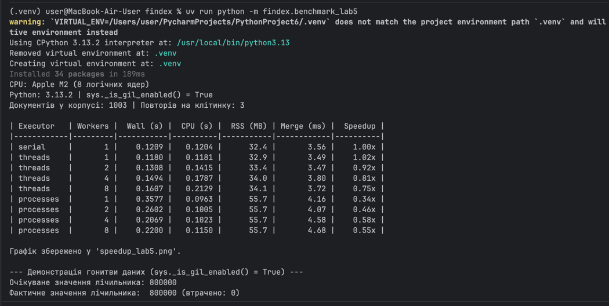

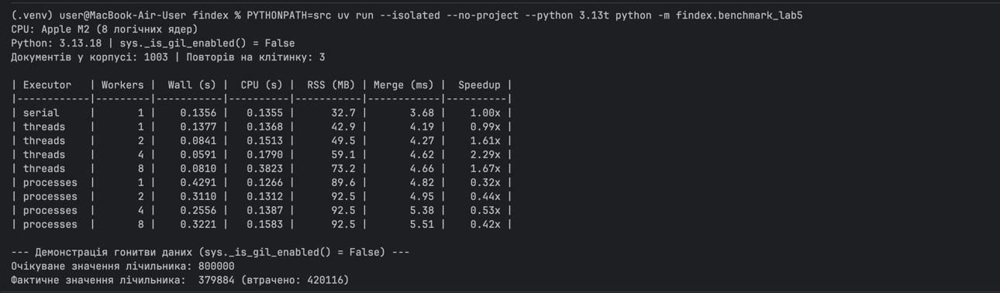

Вимірювання виконані на Apple M2 (8 логічних ядер), корпус — 1003 `.txt` файли з `data/`. Кожен рядок — медіана
трьох прогонів після прогріву файлового кешу; діапазон Wall показує мінімум і максимум цих трьох вимірів.
Кожна конфігурація запускалась в окремому процесі, тому `ru_maxrss` — пік RSS батьківського процесу цього запуску
(не сумарний RSS процесного дерева). CPU для `processes` — CPU батьківського процесу плюс user/system час дочірніх
процесів з `RUSAGE_CHILDREN`. Для Apple M2 `os.cpu_count()` дорівнює 8, отже остання точка є також конфігурацією
«усі логічні ядра».

Команда стандартного виміру: `uv run python -m findex.benchmark_lab5`. Для no-GIL збірки (скрипт вимірів використовує
лише стандартну бібліотеку):

```sh
PYTHONPATH=src python3.13t -m findex.benchmark_lab5
```

#### Стандартний CPython 3.13.2 (`sys._is_gil_enabled() = True`)
| Executor | Workers | Wall median (s) | Wall range (s) | CPU (s) | Parent peak RSS (MB) | Merge (ms) | Speedup |
| :--- | :---: | :---: | :---: | :---: | :---: | :---: | :---: |
| `serial` | 1 | 0.1270 | 0.1270–0.1310 | 0.1270 | 33.5 | 3.92 | 1.00x |
| `threads` | 1 | 0.1272 | 0.1271–0.1275 | 0.1272 | 33.5 | 3.61 | 1.00x |
| `threads` | 2 | 0.1308 | 0.1306–0.1315 | 0.1463 | 33.7 | 3.66 | 0.97x |
| `threads` | 4 | 0.1462 | 0.1461–0.1463 | 0.1791 | 34.5 | 3.83 | 0.87x |
| `threads` | 8 | 0.1588 | 0.1578–0.1593 | 0.2223 | 33.8 | 4.02 | 0.80x |
| `processes` | 1 | 0.3705 | 0.3651–0.3713 | 0.3709 | 52.6 | 3.90 | 0.34x |
| `processes` | 2 | 0.2640 | 0.2636–0.2678 | 0.4371 | 43.5 | 4.29 | 0.48x |
| `processes` | 4 | 0.2201 | 0.2189–0.2240 | 0.6012 | 39.9 | 4.51 | 0.58x |
| `processes` | 8 | 0.2355 | 0.2346–0.2427 | 1.1500 | 38.5 | 4.76 | 0.54x |

#### CPython 3.13.18 free-threaded (`sys._is_gil_enabled() = False`)
| Executor | Workers | Wall median (s) | Wall range (s) | CPU (s) | Parent peak RSS (MB) | Merge (ms) | Speedup |
| :--- | :---: | :---: | :---: | :---: | :---: | :---: | :---: |
| `serial` | 1 | 0.1519 | 0.1482–0.1568 | 0.1510 | 35.8 | 3.99 | 1.00x |
| `threads` | 1 | 0.1597 | 0.1507–0.1779 | 0.1570 | 38.2 | 4.50 | 0.95x |
| `threads` | 2 | 0.0952 | 0.0927–0.1018 | 0.1662 | 39.9 | 4.83 | 1.60x |
| `threads` | 4 | 0.0635 | 0.0628–0.0641 | 0.1858 | 43.6 | 4.85 | **2.39x** |
| `threads` | 8 | 0.0874 | 0.0874–0.0890 | 0.4449 | 49.0 | 4.91 | 1.74x |
| `processes` | 1 | 0.4550 | 0.4355–0.4663 | 0.4529 | 60.8 | 4.95 | 0.33x |
| `processes` | 2 | 0.3263 | 0.3234–0.3417 | 0.5252 | 51.7 | 5.07 | 0.47x |
| `processes` | 4 | 0.2715 | 0.2674–0.2782 | 0.7098 | 47.5 | 5.26 | 0.56x |
| `processes` | 8 | 0.3275 | 0.3261–0.3308 | 1.3782 | 46.5 | 5.63 | 0.46x |

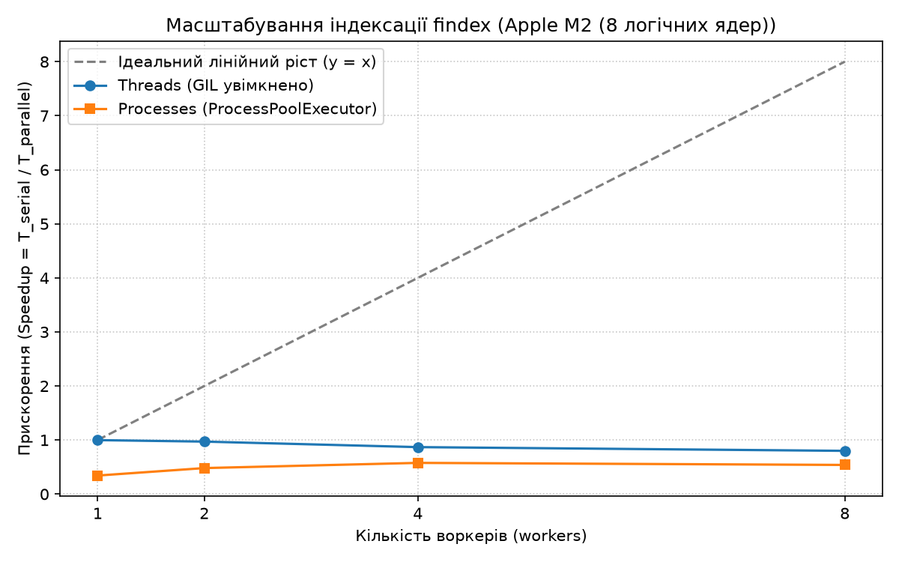


### Аналіз: GIL, процеси, закон Амдала та Python 3.13t

#### 1. Чому потоки під GIL не прискорили індексацію
Індексатор обмежений CPU: токенізація та оновлення Python-словників відбуваються для кожного документа. За увімкненого
GIL лише один потік виконує Python-байткод одночасно. На цьому корпусі 8 потоків повільніші за послідовну побудову
(0.1588 с проти 0.1270 с), а CPU-час зростає (0.2223 с проти 0.1270 с): потоки додають координаційні витрати, але
не додають паралельного виконання Python-коду.

#### 2. Процеси й ціна обходу GIL
Кожен процес має окремий інтерпретатор і GIL, тому CPU-час дочірніх процесів сумується, а Wall може бути коротшим за
цей сумарний CPU-час. Водночас macOS запускає процеси методом `spawn`: треба створити інтерпретатори, передати шляхи
та pickle-нути часткові індекси назад. На корпусі з 1003 невеликих файлів процеси не виграли: найкраще — 0.2201 с
на 4 процесах, усе ще повільніше за serial (0.1270 с). Parent RSS у таблиці не включає пам'ять воркерів, тож реальне
споживання всього дерева процесів вище. Тому серійний executor лишається типовим на цій машині й цьому корпусі.

#### 3. Де в часі `merge` проявляється закон Амдала
Згідно із законом Амдала, максимальне прискорення при розпаралелюванні на $N$ виконавців обмежене часткою коду $s$, 
яка виконується строго послідовно:

$$S(N) = \frac{1}{s + \frac{1 - s}{N}}$$

У цій реалізації `merge_indexes` послідовний і займає близько 3.6–5.6 мс. На free-threaded CPython чотири потоки
індексують за 0.0635 с; merge займає 4.85 мс, тобто близько 7.6% Wall time. Це одна з послідовних частин, що
обмежують прискорення за законом Амдала; на восьми потоках цей корпус уже повільніший, ніж на чотирьох.

#### 4. Що змінилося на Python 3.13t (без GIL) і гонитва даних
На CPython 3.13.18 free-threaded (`sys._is_gil_enabled() = False`) потоки виконують Python-код паралельно: чотири
потоки завершили індексацію за 0.0635 с — у 2.39 раза швидше за serial на тій самій збірці (0.1519 с). Вісім потоків
виявилися повільнішими за чотири; більше воркерів не гарантує кращої швидкодії.

Вимкнення GIL не робить складені операції атомарними. У демонстрації чотири потоки виконали 800 000 неатомарних
інкрементів: під GIL результат був 800 000, а в одному free-threaded прогоні — 461 804 (втрачено 338 196). У findex
часткові індекси не мають спільних словників: кожен воркер володіє локальним станом і наперед виділеним діапазоном
`doc_id`, а parent зливає результати після завершення. Для спільного лічильника потрібен `threading.Lock()`.

# Перевірка 

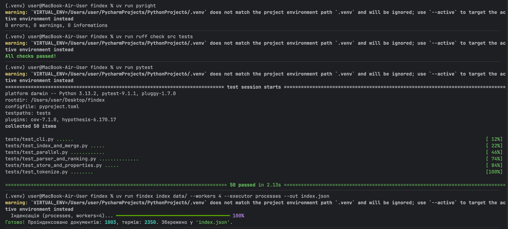


--- 
## Лабораторна робота 6: Асинхронний краулер, індексація та пошук

### Етика та дотримання правил обходу
Обхід проводився на спеціально призначеному відкритому навчальному ресурсі **`https://books.toscrape.com/`** 
(публічна пісочниця для тестування веб-краулерів, `robots.txt` якої дозволяє індексацію). 
Краулер ідентифікує себе чесним заголовком `User-Agent: findex-crawler/0.6 (+https://github.com/Evgeniy224/findex;
educational search engine lab)`, кешує та виконує правила `/robots.txt` для кожного хоста через `RobotsCache`, 
обмежує одночасність двома запитами на хост та паузою `0.2` секунди між запитами. Якщо `robots.txt` повертає помилку
сервера чи недоступний, хост закривається для обходу; `404` для самого `robots.txt` означає, що правил немає.

### Архітектура та ключові компоненти (`findex.crawler`)
* **HTTP-клієнт з таймаутами та повторами (`fetch.py`)**: `httpx.AsyncClient` із контролем часу очікування 
через `asyncio.timeout`, повторами лише на тимчасових збоях (`429`, `500`, `502`, `503`, `504`, 
таймаути та мережеві помилки) з exponential backoff + jitter і підтримкою заголовка `Retry-After`. 
Помилки `404` не повторюються; `Retry-After` не обрізається. Редирект перевіряється до наступного запиту: дозволені
лише редиректи на той самий host/port, і для кінцевого URL повторно перевіряється `robots.txt`.
* **Дотримання `robots.txt` (`robots.py`)**: асинхронний кеш `RobotsCache` на базі `urllib.robotparser.RobotFileParser` 
із блокуванням `asyncio.Lock` на хост для запобігання дублюючим запитам до `/robots.txt`; на помилках мережі та 5xx
обхід забороняється за замовчуванням.
* **Асинхронний генератор обходу (`crawl.py`)**: канонізація URL (`http/https`, нижній регістр схеми й хоста, 
видалення `#fragment`, нормалізація шляху, сортування query-параметрів), дедуплікація через `seen: set[str]`, 
черга `asyncio.Queue`, воркери під `asyncio.TaskGroup`, глобальний і per-host семафори та коректне скасування 
воркерів на `max_pages`. Резервування слотів не дозволяє зробити зайві успішні запити, а черга очищується під час зупинки.
* **Потокова інтеграція з CLI (`cli.py`, `corpus.py`, `index.py`)**: команда `findex crawl` пише сторінки у потоковий
JSONL по мірі надходження з живою панеллю метрик (`Rich Live`) та журналом `crawl.log`; файловий запис винесений через
`asyncio.to_thread`, мережеві запити асинхронні. Індексація виконується окремо поза циклом подій через `findex index`.

### Результати бенчмарку краулера (200 сторінок, однакові параметри ввічливості)

У кожному запуску: seed `https://books.toscrape.com/`, `--max-pages 200`, `--per-host 2`, `--delay 0.2`; змінювався лише
`--concurrency`. Повторити можна, наприклад, так:

```sh
uv run findex crawl https://books.toscrape.com/ --max-pages 200 --concurrency 1 --per-host 2 --delay 0.2 --out data/crawl_c1.jsonl --log crawl_c1.log
uv run findex crawl https://books.toscrape.com/ --max-pages 200 --concurrency 5 --per-host 2 --delay 0.2 --out data/crawl_c5.jsonl --log crawl_c5.log
uv run findex crawl https://books.toscrape.com/ --max-pages 200 --concurrency 20 --per-host 2 --delay 0.2 --out data/crawl_c20.jsonl --log crawl_c20.log
```

| `concurrency` | `per-host` | Сторінки | Помилки | Wall (s) | Pages/s | Speedup | Peak RSS (MB) |
| :---: | :---: | :---: | :---: | :---: | :---: | :---: | :---: |
| 1 | 2 | 200 | 0 | 44.96 | 4.45 | 1.00x | 70.1 |
| 5 | 2 | 200 | 0 | 41.07 | 4.87 | 1.09x | 59.2 |
| 20 | 2 | 200 | 0 | 41.39 | 4.83 | 1.09x | 61.2 |

### Аналіз продуктивності та архітектурні висновки
1. **Що показав цей вимір:** asyncio дає змогу перекривати очікування мережі без окремого потоку на кожен запит, але
   concurrency 20 не прискорила цей ввічливо обмежений crawl відносно concurrency 5. Загальна швидкість уперлася у
   `--delay 0.2` і `--per-host 2`; це свідоме обмеження навантаження на сайт, а не свідчення, що asyncio не корисний.
   Для демонстрації вищої concurrency потрібен контрольований локальний mirror/сервер, не більший тиск на публічний сайт.
2. **Не блокувати цикл подій:** HTTP і robots-запити використовують async-клієнт, файлові записи відбуваються через
   `asyncio.to_thread`. CPU-індексація запускається окремо після crawl командою `findex index`.
3. **Перевірка 404:** новий benchmark не мав помилок, тому не приписуємо йому вигаданий рядок журналу. Натомість
   `tests/test_crawler.py::test_crawl_logs_404_once_and_continues` із `httpx.MockTransport` перевіряє, що 404 має
   `attempts=1`, `error="HTTP 404"` і не повторюється; окремий тест перевіряє блокування cross-host редиректу до
   відправлення запиту на інший host.

# Тести Lab 5 і Lab 6:
uv run pytest tests/test_parallel.py tests/test_crawler.py -q

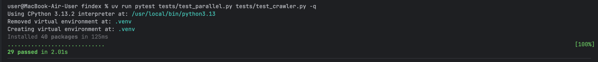

# Повні перевірки проєкту:
uv run pytest -q
uv run ruff check src/findex/cli.py src/findex/crawler/fetch.py src/findex/crawler/robots.py src/findex/crawler/crawl.py src/findex/benchmark_lab5.py tests/test_crawler.py
uv run pyright

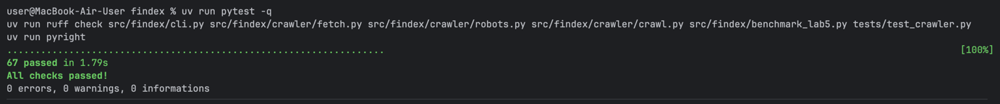

# Демонстрація краулера — обмежений ввічливий запуск на 20 сторінок
uv run findex crawl https://books.toscrape.com/ --max-pages 20 --concurrency 5 --per-host 2 --delay 0.2 --out /tmp/findex-lab6.jsonl --log /tmp/findex-lab6.log

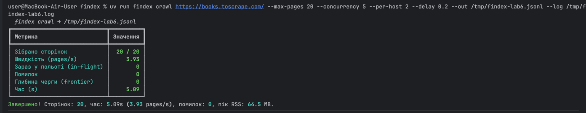

# JSONL читається індексатором:
uv run findex index /tmp/findex-lab6.jsonl --out /tmp/findex-lab6-index.json

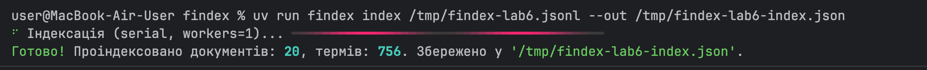


